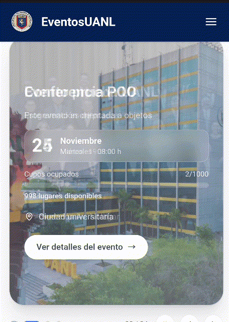

# Página web: Eventos UANL

<div align="center">
  
  
</div>

- Producto integrador de aprendizaje para la materia de Deserrollo web: Tecnologías cliente.

##  Index

- [About](#about)
- [Usage](#usage)
  - [Installation](#installation)
  - [Commands](#commands)
- [Development](#development)
  - [Pre-Requisites](#pre-requisites)
  - [File Structure](#file-structure)
  - [Build](#build)
- [Gallery](#gallery)
- [Credit/Acknowledgment](#creditacknowledgment)

##   About
Eventos UANL es la reimaginación de la plataforma de eventos de la Universidad Autónoma de Nuevo León.

El listado de eventos actual se convierte en una plataforma web completa donde los usuarios se pueden registrar para administrar y asistir a sus eventos mediante un pase. El personal autorizado puede gestionar sus eventos y registrar asistencias en la misma plataforma.

##  Usage

Este sistema está diseñado para hostear su backend a través de supabase. Se debe iniciar una base de datos de supabase con las tablas necesarias.

### Installation

- Requisitos: Node.js y pnpm.
- Configuración inicial:

  ```bash
  git clone https://github.com/Elorza4A/eventos-uanl
  cd eventos-uanl
  pnpm install
  ```

- Crear `.env.local` con las variables de Supabase que correspondan:

  ```env
  NEXT_PUBLIC_SUPABASE_URL=
  NEXT_PUBLIC_SUPABASE_ANON_KEY=
  ```

### Commands

Los scripts configurados en [package.json](<E:/UANL - Ciencias Computacionales/Octavo semestre/Front end/PIA/eventos-uanl/package.json>) son:

```bash
pnpm dev     # Iniciar en desarrollo
pnpm lint    # Ejecutar ESLint
pnpm build   # Crear la compilación de producción
pnpm start   # Iniciar la aplicación compilada
```

## Development

### Pre-Requisites

Pre-requisitos y dependecias que se necesitan para este proyecto:

- Base de datos Supabase
- Node.js
- Pnpm

### File Structure

```text
src/
├── app/          # Páginas, rutas y acciones de Next.js
├── components/   # Componentes de interfaz
├── config/       # Configuración, como permisos
├── lib/          # Acceso a datos, autenticación y validaciones
├── types/        # Tipos de la aplicación
└── utils/        # Clientes y utilidades de Supabase
supabase/         # Esquema, funciones y tareas SQL
public/           # Recursos estáticos
```

### Build

Usar el siguiente comando en la raiz del repositorio para generar la buid del proyecto:

```bash
pnpm build
```

## Gallery



## Credit/Acknowledgment

Colaboradores:

- Alexis Felipe Elorza Obregón
  - Diseño y sección Personal autorizado
- Eder Abraham Sampayo Gonzalez
  - Backend y Sección asistentes
- Edgar Aurelio Santiago Santiago
  - Testing y sección asistentes
